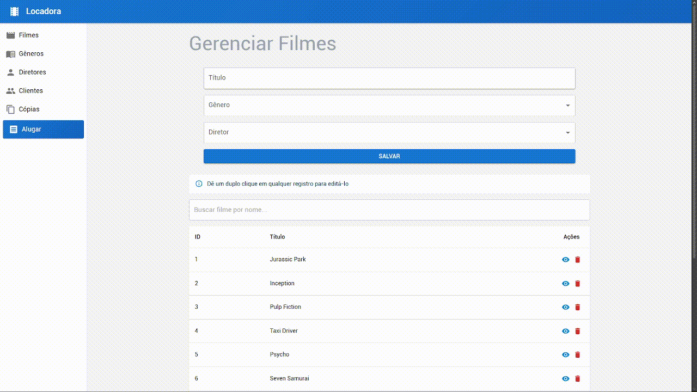

# Sistema Locadora

**CEFET/RJ – Nova Friburgo**
**Bacharelado em Sistemas de Informação**

_Sistema de Locadora, desenvolvido em react._



---

## 🌐 Tecnologias utilizadas

### Frontend 🎨

**🔧 Linguagens e Ferramentas:**

- HTML
- CSS
- TypeScript
- React
- Vite
- npm

**📚 Bibliotecas e Frameworks TypeScript:**

- Material UI (MUI)
- React Router DOM

---

## Primeiros Passos 🏃‍♂️

Para rodar o projeto localmente:

1. Instale as dependências:
   ```bash
   npm install
   ```
2. Inicie o servidor de desenvolvimento:
   ```bash
   npm run dev
   ```

---

## Estrutura de Diretórios 🗃

| **📂**                                       | **Descrição**                                           |
| -------------------------------------------- | ------------------------------------------------------- |
| [/src/](./src/)                              | Código-fonte do frontend                                |
| 🎨**Estrutura do Frontend**                  |                                                         |
| [/src/components/](./src/components/)        | Componentes reutilizáveis divididos por entidade        |
| [/src/pages/](./src/pages/)                  | Páginas completas da aplicação                          |
| [/src/types/](./src/types/)                  | Definições de tipos TypeScript                          |
| [/src/App.tsx](./src/App.tsx)                | Componente principal com rotas e menu lateral           |
| [/src/App.css](./src/App.css)                | Estilos globais                                         |
| [/src/main.tsx](./src/main.tsx)              | Ponto de entrada da aplicação                           |

---

## 📝 Descrição do Negócio

O Sistema de Locadora é uma aplicação web para gerenciar as operações de uma locadora de filmes. Permite o cadastro e gerenciamento de filmes, gêneros, diretores, clientes e cópias físicas, além de controlar o aluguel e devolução.

---

## ⚙️ Funcionalidades (CRUDs)

1. **Gêneros**: ID e Descrição.
2. **Diretores**: ID, Nome e Nacionalidade.
3. **Clientes**: ID, Nome, CPF e Data de Nascimento.
4. **Filmes**: ID, Título, Gênero e Diretor.
5. **Cópias**: ID, Código, Alugado (boolean) e Filme.
6. **Aluguel**: Controle de empréstimo e devolução de cópias.

---

## Comandos disponíveis:

- `npm install` - Instala as dependências
- `npm run dev` - Roda o frontend em ambiente de desenvolvimento